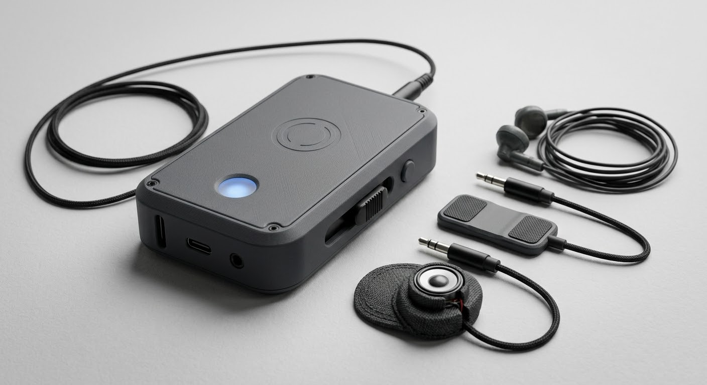
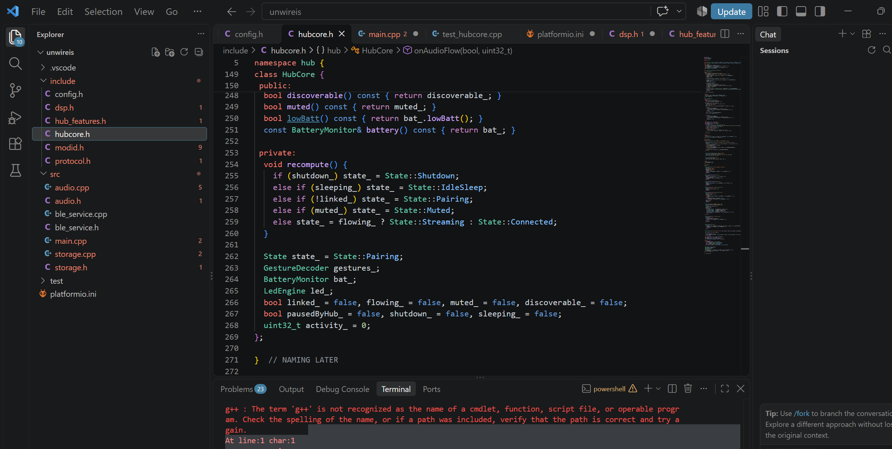

# unwireis

A wireless ESP32-based utility hub built for the Hack Club Highway project.

The goal of this project is to create a compact and expandable device powered by an ESP32 microcontroller. The firmware is written in C++ using PlatformIO and is designed to support Bluetooth communication, audio processing, storage management, and modular feature expansion.

## Features

- ESP32 firmware written in C++
- Bluetooth Low Energy communication
- Audio subsystem
- Persistent storage support
- Modular architecture using separate feature headers
- PlatformIO development environment

## Repository Structure

- `src/` contains the implementation files
- `include/` contains project headers
- `test/` contains unit tests
- `platformio.ini` contains build configuration

## Current Status

Development is currently focused on building the firmware architecture and implementing the core HubCore framework before hardware integration begins.

## Future Plans

- Complete firmware features
- Integrate with custom PCB hardware
- Add enclosure design
- Expand BLE functionality
- Add more device modules

## Photos

